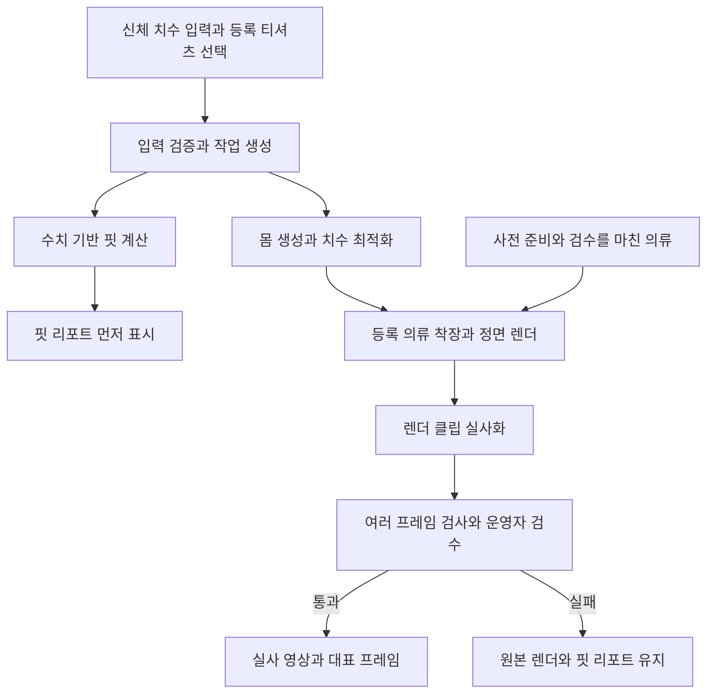
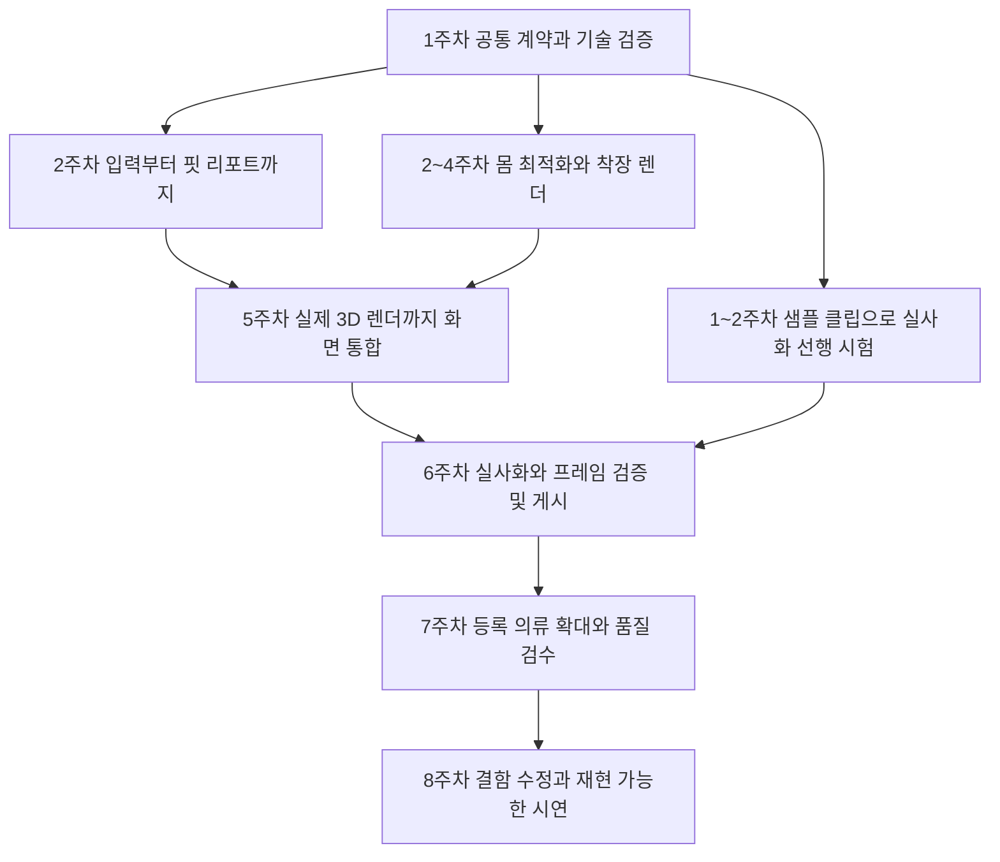

# Fit Ruler

신체 치수와 등록 티셔츠의 실측을 비교하고, 3D 착장과 실사화 영상으로 확인하는 가상 피팅 프로젝트입니다.

**현재 단계: 설계 및 명세서 초안 작성.** 이 저장소는 프로젝트 안내와 개발 명세서 초안을 관리합니다. 아래 기능과 기술 구성은 구현 목표이며, 실행 가능한 애플리케이션 코드는 아직 포함하지 않습니다.

## 개발 명세서

[개발 명세서 초안 v0.1 내려받기](docs/AIMAX-specification-draft-v0.1.docx)

명세서는 초기 아키텍처의 AIMAX 반팔 티셔츠 가상 피팅 설계를 바탕으로 작성했습니다. 기능·화면·판정 규칙·데이터·API·오류 처리·검수 기준과 4인 개발 계획을 포함합니다.

| 표시 | 의미 |
| --- | --- |
| `[원안]` | 초기 아키텍처에 명시된 방향 |
| `[추천안 R01~R20]` | 미정 항목에 제안한 구현 방식과 초기값 |
| 초기 검증값 | 실제 샘플과 검수 결과로 조정할 값. 달성한 성능이나 공인 기준을 의미하지 않음 |

개발을 시작할 때는 명세서의 **14~16장**에서 개발 흐름·역할·첫 주 할 일을 확인하고, **17장**의 추천 결정 목록을 팀에서 검토합니다. 이 README는 프로젝트 개요이며, 상세 기준은 명세서를 참고합니다.

## 프로젝트 목표

- **치수로 설명할 수 있는 핏 리포트:** 신체와 의류 실측의 차이, 부위별 판정과 근거를 제공합니다.
- **선택한 사이즈를 유지하는 착장:** 사용자의 몸을 치수에 맞추고, 선택한 옷의 고정 치수를 유지해 착장합니다.
- **실사화 결과의 품질 확인:** 원본 렌더와 생성 영상의 색·실루엣을 비교하고, 검수를 통과한 결과를 제공합니다.
- **독립적인 결과 제공:** 영상이 늦거나 실패해도 완료된 수치 기반 리포트를 확인할 수 있도록 합니다.

## 첫 버전의 범위

다음은 명세서의 추천안을 적용한 MVP 범위입니다.

| 항목 | 목표 범위 |
| --- | --- |
| 의류 | 성인용 기본 반팔 라운드넥, 무지 티셔츠 |
| 사용자 입력 | 키·가슴둘레·허리둘레·어깨너비·팔길이, 단위 cm |
| 의류 선택 | 미리 준비하고 검수한 티셔츠의 핏형·사이즈·색상 선택 |
| 등록 규모 | 1 SKU로 시작해 3 SKU로 검증한 뒤 최종 12 SKU 목표 |
| 수치 결과 | 부위별 신체 치수·옷 치수·여유량·판정·설명 |
| 시각 결과 | 정면 고정 자세의 3D 렌더, 검수를 통과한 실사 영상과 대표 프레임 |
| 선택 기능 | 브라우저 3D 회전 미리보기와 취향 기반 사이즈 추천 |
| 후속 범위 | 임의 의류 업로드, 사진 기반 몸 복원, 여러 의상, 걷기·포즈 전환 영상 |

SKU는 핏형·사이즈·색상이 하나로 확정된 선택 단위입니다. 최종 12 SKU는 기본핏·여유핏 2종 × S·M·L 3개 × 색상 2개를 예시로 한 추천안입니다.

## 사용자 실행 흐름



수치 계산과 영상 생성은 별도 경로로 실행합니다. 사용자는 리포트만 실행하거나 영상을 함께 요청할 수 있습니다.

### 핏 판정에서 구분할 점

| 부위 | 비교 방식 |
| --- | --- |
| 가슴 | 의류 전체 가슴둘레에서 신체 가슴둘레를 뺀 여유량 |
| 허리 | 같은 위치의 측정값임이 확인된 의류만 둘레 비교. 대응이 불명확하면 정보 부족으로 표시 |
| 어깨 | 의류 어깨너비와 신체 어깨너비 비교 |
| 소매와 기장 | 첫 버전에서는 의류 실측 제공. 반팔 소매 길이와 사람의 전체 팔길이를 직접 차감하지 않음 |

판정 구간은 명세서에 표시한 초기 추천값으로 시작해 실제 착용 대조로 조정합니다. 다섯 치수로 생성한 몸은 추정 체형이며, 영상의 색·실루엣 통과가 실제 착용감의 정확도를 입증하는 것은 아닙니다.

## 아키텍처

초기 설계는 **표현·로직·데이터 및 어댑터의 3계층**을 사용합니다.

| 계층 | 책임 | 구현 추천안 |
| --- | --- | --- |
| 표현 | 치수 입력, 의류 선택, 진행 상태와 결과, 운영 화면 | React·TypeScript |
| 로직 | 입력 검증, 핏 계산, 작업 진행·오류·재시도 관리, 포트 정의 | FastAPI·Python 도메인 코드 |
| 데이터 및 어댑터 | 파일과 결과 저장, 외부 도구 연결 | PostgreSQL·Redis/Celery·S3 호환 저장소와 도구 어댑터 |

로직 계층이 다음 여섯 포트를 정의하고, 외부 도구를 연결하는 어댑터가 이를 구현합니다.

| 포트 | 역할 | 도구 후보 |
| --- | --- | --- |
| 의류와 결과 저장 | 등록 의류 조회, 산출물 저장 | 데이터베이스·객체 저장소 |
| 패턴 생성 | 기본 패턴과 고정 SKU 의류 준비 | GarmentCode |
| 몸 생성과 측정 | 몸 생성·재측정·치수 최적화 | PyTorch·SMPL |
| 착장과 렌더 | 사용자별 착장, 천 시뮬레이션, 정면 렌더 | Blender |
| 실사화 | 렌더 클립을 실사 영상으로 변환 | fal API·LTX 2.3 |
| 프레임과 비교 | 프레임 추출, 색·실루엣 검사, 대표 프레임 선택 | SAM 2 기반 분할과 비교 처리 |

이 구성은 채택 전 검증할 추천안입니다. 첫 주에 모델 사용 조건, 패턴에서 봉제 메시로의 변환, 도구 간 단위·좌표·파일 호환과 외부 API 연결을 확인합니다. 장시간 작업은 웹 요청과 분리된 작업자로 실행하고, 실제 동작한 버전을 고정합니다.

## 개발 순서

**한 벌의 티셔츠로 입력부터 핏 리포트까지 먼저 완성합니다.** 동시에 3D와 실사화 도구를 샘플 파일로 시험해, 통합 전에 연결 문제를 확인합니다.



### 마일스톤

| 단계 | 목표 | 확인할 결과 |
| --- | --- | --- |
| M0·1주 | 입력과 파일 계약, 한 벌의 기술 검증 | 공통 JSON, 고정 의류 메시, 몸 파일, Blender 착장 시험과 실사화 API 결과 |
| M1·2주 | 수치 기반 기능 완성 | 실제 API를 사용한 입력 → 핏 리포트 |
| M2·4주 | 3D 핵심 경로 검증 | 한 SKU와 대표 몸 3개에서 몸·착장·렌더 성공 |
| M3·5주 | 화면과 실제 렌더 통합 | 진행 상태, 리포트 선행 표시, 원본 렌더와 부분 실패 처리 |
| M4·6주 | 실사화와 검증 연결 | 여러 프레임 검사 → 운영자 검수 → 통과 영상 게시 |
| M5·7주 | 의류 확대와 품질 확인 | 12 SKU, 고정 검수집, 시간·비용과 실패 복구 측정 |
| M6·8주 | 시연 및 인수 | 필수 기능 통합, 설치·재현 문서와 검수 결과 |

8주는 **4명 전일제 참여를 가정한 초기 계획**입니다. 첫 주 기술 검증 후 실제 작업량에 맞춰 조정합니다. 브라우저 회전 미리보기 같은 선택 기능은 필수 경로가 통과한 후 진행합니다.

## 4명 역할 분담 추천안

팀원 이름과 실제 강점에 맞춰 A~D를 배정합니다.

| 역할 | 주 책임 | 주요 산출물 |
| --- | --- | --- |
| A·화면과 사용성 | 입력·측정 안내, 리포트·진행·결과, 관리·검수 화면, 웹 통합 검수 | 웹 화면, 상태 매핑과 사용자 가이드 |
| B·서버와 핏 판정 | 핏 규칙, API·DB·큐·저장, 작업 상태와 재시도, 통합·배포 조율 | API 계약, 리포트 엔진, 작업 관리자와 설치 문서 |
| C·의류와 착장 렌더 | 의류 실측·패턴·봉제 메시, 배치·충돌·천 안정화, 원본 렌더 | 등록 의류 자산, 착장·렌더 어댑터와 마스크 |
| D·몸과 실사화 검증 | 몸 생성·측정·최적화, 실사화 API, 프레임·색·실루엣 검증 | 몸·실사화·검증 어댑터와 품질 결과 |

C와 D는 몸·의류의 단위와 좌표, 착장 결과를 함께 검토합니다. A와 B는 API와 화면 상태를 함께 확인합니다. D의 업무가 몰리면 A가 검수 도구를, B가 외부 요청의 큐·시간 제한·비용 처리를 지원합니다.

## 첫 주에 할 일

- [ ] 다섯 치수의 측정 방법, 단위와 공통 입력 JSON 고정
- [ ] 티셔츠 1 SKU의 실측·출처·패턴과 봉제 메시 준비
- [ ] 몸 파일의 생성·재측정과 허용 오차 확인
- [ ] 몸과 옷의 좌표·단위·기준점 및 파일 manifest 합의
- [ ] 모의 응답으로 입력과 핏 리포트 화면 연결
- [ ] Blender 착장과 렌더, 샘플 클립의 실사화 API 시험
- [ ] 실제 결과를 보고 8주 일정과 담당별 인수 시점 조정

개별 작업 24개의 담당자·선행 조건·완료 산출물은 [명세서](docs/AIMAX-specification-draft-v0.1.docx)의 **15장**에 정리합니다.

## 현재 저장소 구성

```text
.
├── README.md
└── docs/
    └── AIMAX-specification-draft-v0.1.docx
```

애플리케이션의 디렉터리와 설치·실행 명령은 첫 구현이 추가될 때 함께 문서화합니다.

## 협업과 문서 관리

- 작업마다 담당자 한 명, 선행 조건과 완료 기준을 정합니다.
- 작은 변경 단위로 검토하고, 주 2회 이상 공통 샘플로 통합합니다.
- 입력·API·단위·좌표가 바뀌면 계약 버전과 샘플 파일을 함께 갱신합니다.
- 수치 리포트와 영상의 상태·오류를 각각 관리합니다.
- 선택한 의류의 치수를 사용자 몸에 맞게 바꾸지 않습니다.
- 임계값·기술 구성·범위가 바뀌면 명세서와 README를 함께 갱신합니다.

Word 명세서는 현재의 상세 초안입니다. 다음 개정부터는 변경 내용을 PR 설명에 남기고, 팀이 합의한 버전 번호로 관리합니다.
